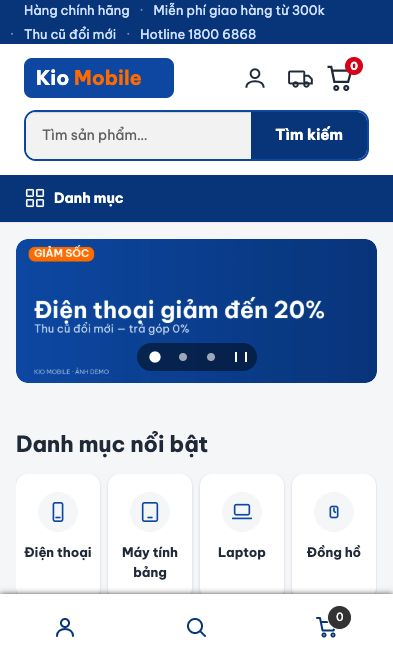
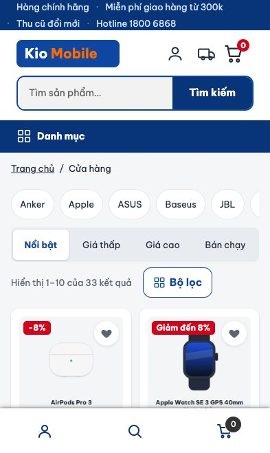
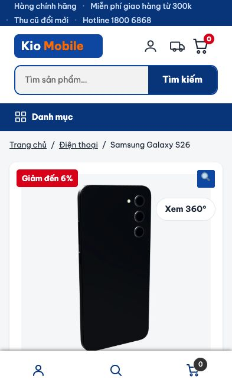
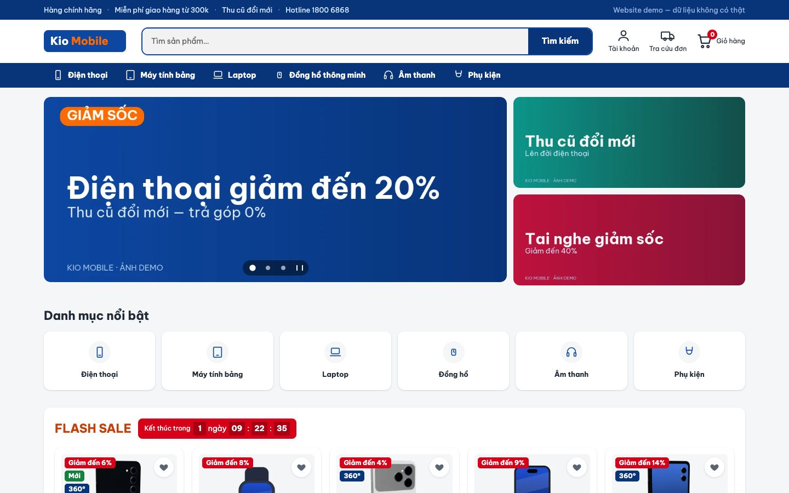

# Kio Mobile

Website demo bán điện thoại, máy tính bảng và đồ điện tử, dựng bằng **WordPress + WooCommerce**, chạy thật trên Azure sau Cloudflare.

**Demo:** https://shop.kiotrandev.tech

> Đây là project học tập, không bán hàng thật. `Kio Mobile` là thương hiệu tự đặt, ảnh sản phẩm và mô hình 3D là hình minh hoạ tự tạo. Website không dùng cổng thanh toán thật và chưa gửi email.

| Trang chủ | Cửa hàng | Sản phẩm |
|---|---|---|
|  |  |  |



## Tính năng

- **Cửa hàng:** 33 sản phẩm, biến thể theo màu và dung lượng, thông số có nguồn từ trang hãng (30/33 sản phẩm).
- **Mô hình 3D xoay 360°** cho 8 sản phẩm, tự dựng bằng Three.js.
- **Mua hàng kiểu Việt Nam:** thanh toán COD và chuyển khoản, form địa chỉ Việt Nam, kiểm tra số điện thoại, coupon có mức giảm tối đa.
- **Khuyến mãi:** flash sale đếm ngược, nhãn giảm giá, trả góp, sale demo tự gia hạn.
- **Bộ lọc** theo thương hiệu, khoảng giá và thuộc tính; so sánh, yêu thích, đánh giá có ảnh.
- **Code tuỳ biến:** hook, custom post type, Gutenberg block, REST API trong plugin `kio-store`.

## Công nghệ

| Lớp | Lựa chọn |
|---|---|
| CMS | WordPress, WooCommerce |
| Giao diện | Storefront + child theme `kio-child` (classic theme) |
| Chức năng | Plugin tự viết `kio-store` |
| Dữ liệu | MySQL 8.4, Redis (object cache), Cache Enabler (page cache) |
| Hạ tầng | Docker Compose, Azure VM, Caddy (HTTPS), Cloudflare |
| Tự động hoá | WP-CLI, GitHub Actions (CI/CD) |

```
Khách → Cloudflare → Caddy (HTTPS, chặn Host lạ) → Apache + PHP → MySQL, Redis
```

## Những gì đã làm

- **Hiệu năng:** Lighthouse mobile 99 điểm ở trang sản phẩm khi đã có cache. Trên VM 1 GiB RAM, toàn bộ site dùng khoảng 300–450 MiB.
- **Bảo mật:** header bảo mật, chặn PHP trong uploads, giới hạn đăng nhập theo IP thật, hỗ trợ 2FA, phân quyền, quét lỗ hổng, backup và khôi phục đã thử.
- **Vận hành:** mọi phiên bản đều cố định, cài lại toàn bộ site bằng một lệnh trong khoảng 8 phút, dịch vụ tự bật lại sau khi VM khởi động lại.
- **Kiểm thử:** smoke test như khách hàng, thử tấn công, kiểm tra hành vi JS và độ tương phản.

## Chạy ở máy

Cần Docker Desktop và các cổng `8080`, `8081`, `8025` còn trống.

```bash
cp .env.example .env        # rồi đổi các mật khẩu trong .env
./scripts/install.sh        # dựng toàn bộ cửa hàng, khoảng 8 phút
```

| Dịch vụ | Địa chỉ |
|---|---|
| Website | http://localhost:8080 |
| wp-admin | http://localhost:8080/wp-admin (tài khoản trong `.env`) |
| phpMyAdmin | http://localhost:8081 |
| Mailpit (hộp thư giả) | http://localhost:8025 |

| Việc | Lệnh |
|---|---|
| Chạy WP-CLI | `docker compose run --rm wpcli <lệnh>` |
| Kiểm tra như khách | `python3 scripts/smoke-test.py` |
| Thử tấn công site local | `python3 scripts/security-check.py` |
| Sao lưu ngay | `docker compose exec backup bash /scripts/backup.sh` |
| Khôi phục | `./scripts/restore.sh backups/<tên-bản>` (đè dữ liệu hiện tại) |
| Xoá sạch, cài lại | `./scripts/reset.sh` (xoá database và ảnh upload) |

Lint giống CI, không cần cài PHP:

```bash
docker run --rm -v "$PWD":/app -w /app composer:2 sh -c "composer install -q && vendor/bin/phpcs"
docker run --rm -v "$PWD":/mnt -w /mnt koalaman/shellcheck:v0.11.0 -x scripts/*.sh
```

## CI/CD

`.github/workflows/ci.yml` chạy mỗi khi push lên `main` hoặc mở Pull Request:

| Job | Việc |
|---|---|
| **Lint** | Cú pháp PHP, PHPCS theo chuẩn WordPress, JSON, Python, shellcheck |
| **Smoke test** | Dựng site từ đầu, kiểm tra như khách, thử tấn công |
| **Deploy** | Chỉ chạy trên `main` khi 2 job trên đạt: cập nhật code trên server rồi kiểm tra site |

Deploy chỉ đưa code lên server, không đụng database. Key SSH của CD bị giới hạn ở đúng việc deploy, không mở được shell.

## Cấu trúc

```
├── docker-compose.yml        # cấu hình chung, chạy ở máy dev
├── docker-compose.vm.yml     # giới hạn bộ nhớ cho VM nhỏ
├── docker-compose.prod.yml   # server thật: Caddy, cấu hình production
├── docker/                   # cấu hình Apache, Caddy
├── wp-content/
│   ├── themes/kio-child/     # phần hiển thị
│   └── plugins/kio-store/    # phần chức năng, mỗi tính năng một file
├── data/                     # dữ liệu demo (JSON), mô hình và ảnh
├── scripts/                  # cài đặt, nạp dữ liệu, kiểm thử, sao lưu, deploy
└── tools/models/             # dựng mô hình 3D bằng Three.js
```

Chỉ `kio-child` và `kio-store` nằm trong git. Core WordPress, plugin cài từ kho và `uploads` nằm trong volume Docker.
